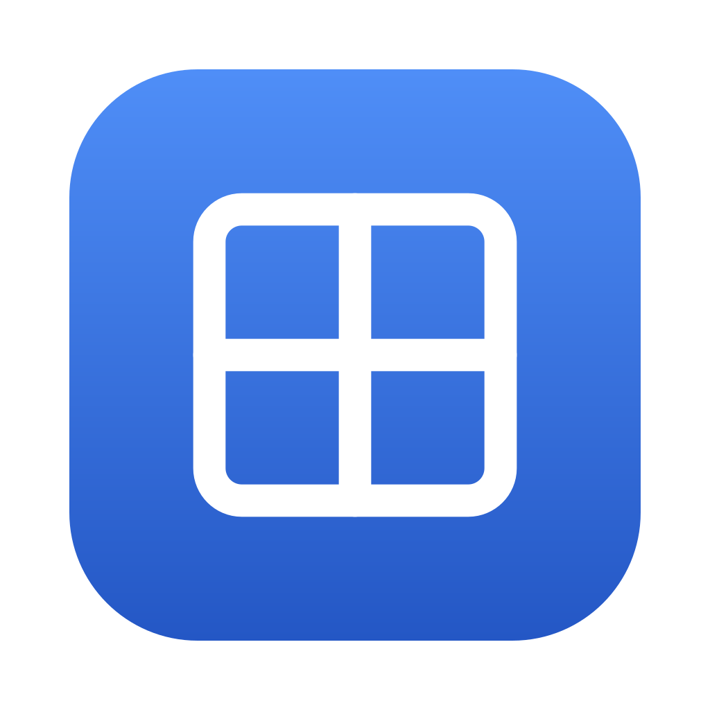

<p align="center">
  
</p>

# WindowPin

A lightweight macOS menu bar utility that keeps any window visually on top without stealing focus.

**WindowPin is a fork of [Mac-Window-Pin](https://github.com/iconoclas/Mac-Window-Pin) (WinTop) by [icos](https://github.com/iconoclas).** The ScreenCaptureKit mirror design and the original implementation are theirs. This fork adds clickable menu items, click-to-refocus, per-display capture scale, smoother drag/resize sync, a stable code-signing setup, and [Lucide](https://lucide.dev) icons. Both are MIT licensed.

## How It Works

WindowPin uses **ScreenCaptureKit** to create a floating live mirror of the target window. The mirror panel sits above all other windows at the floating level while the real window stays wherever it is in the z-order. The real window keeps focus and keyboard input.

```
┌─────────────────────────────────┐
│  Mirror Panel (.floating)       │  ← always visible on top
│  [live SCStream render]         │  ← click-through while its app is active
└─────────────────────────────────┘
         ↕ click the mirror from another app to bring the real window back
┌─────────────────────────────────┐
│  Real Window (normal z-order)   │  ← still fully interactive
└─────────────────────────────────┘
```

## Features

- **⌥ + P** pins the frontmost window, **⌥ + U** unpins the most recent one. Both also available from the menu bar menu.
- Pin **multiple windows** at once
- Mirror follows the window when moved or resized, with capture resolution matching the display it is on
- **Click the mirror** while another app is active to bring the real window back to front
- No focus stealing: your typing is never interrupted
- Permission prompts only appear when a permission is actually missing

## Requirements

| Item | Requirement |
|---|---|
| macOS | **14 Sonoma or later** (`SCContentFilter(desktopIndependentWindow:)` needs macOS 14+) |
| Architecture | Apple Silicon and Intel |
| Permissions | **Accessibility** and **Screen Recording** |
| Toolchain | Swift 5.9+ (Xcode 15+ or Command Line Tools) |

Tested on macOS 15 Sequoia and macOS 26 Tahoe.

## Install

```bash
git clone https://github.com/david-rios-uipath/window-pin.git
cd window-pin
./build.sh
```

`build.sh` compiles the Swift source, signs the app, copies it to `/Applications`, and launches it. On first launch macOS asks for Accessibility and Screen Recording. Grant both in **System Settings → Privacy & Security**, then quit and relaunch WindowPin from `/Applications`.

### Stable code signing (recommended)

macOS ties Accessibility and Screen Recording grants to the app's code signature. The default ad-hoc signature changes on every rebuild, so you would be re-prompted after each build. To avoid that, create a self-signed code-signing certificate once:

1. Keychain Access → menu **Keychain Access → Certificate Assistant → Create a Certificate**
2. Name `WindowPin Dev`, Identity Type **Self Signed Root**, Certificate Type **Code Signing**
3. Double-click the new certificate → **Trust** → Code Signing: **Always Trust**

`build.sh` signs with `WindowPin Dev` when it exists and falls back to ad-hoc otherwise. Use a different identity with `SIGN_IDENTITY="My Cert" ./build.sh`.

### Launch at login

System Settings → General → Login Items → **+** → `/Applications/WindowPin.app`.

## Usage

1. Click the window you want to keep on top
2. Press **⌥ + P**. A floating mirror appears and a short toast confirms the pin
3. Switch to other apps. The mirror stays visible
4. Click the mirror to jump back to the real window
5. Press **⌥ + U** to unpin (repeat for multiple pinned windows)

## Known Limitations

| Limitation | Reason |
|---|---|
| About one frame of drag lag | Mirror renders through the SCStream capture pipeline, not direct compositing |
| Requires Screen Recording | ScreenCaptureKit TCC requirement on macOS 14+ |
| Mirror is read-only | Clicking it refocuses the real window; you interact with the real window, not the copy |
| No window controls on the mirror | By design; the mirror is a borderless overlay |

## Architecture

Single file, no dependencies.

```
WindowPin.swift
├── CaptureManager      — SCStream setup, frame delivery, capture size/rate updates
├── MirrorPanel         — NSPanel overlay, AXObserver position sync, click-to-refocus
├── WindowPinManager    — Active mirrors, pin/unpin logic, HUD toast
└── AppDelegate         — Menu bar, Carbon hotkeys, permission checks
```

Key choices:
- `SCContentFilter(desktopIndependentWindow:)` captures one window without the rest of the screen
- `AXObserver` on `kAXWindowMoved` / `kAXWindowResized` gives event-driven sync with no polling when idle
- Frames enqueue straight to `AVSampleBufferDisplayLayer` from the capture queue; capture reconfiguration is debounced
- `.nonactivatingPanel` at `.floating` level stays above normal windows without joining focus management

## Credits

- [Mac-Window-Pin](https://github.com/iconoclas/Mac-Window-Pin) by icos. The original project this fork is based on.
- [Topit](https://github.com/lihaoyun6/Topit). Same ScreenCaptureKit mirror approach; upstream's inspiration and a polished, signed alternative if you want an app rather than a build-it-yourself tool.
- [AlwaysOnTop](https://github.com/AirBalloonDev/AlwaysOnTop). Hotkey and window manager patterns.
- [Lucide](https://lucide.dev). The `pin`, `pin-off`, and `grid-2x2` icons used in the menu bar, HUD toasts, and app icon. ISC license.

## License

MIT, see [LICENSE](./LICENSE). Original work © icos (iconoclas); modifications © David Rios.
